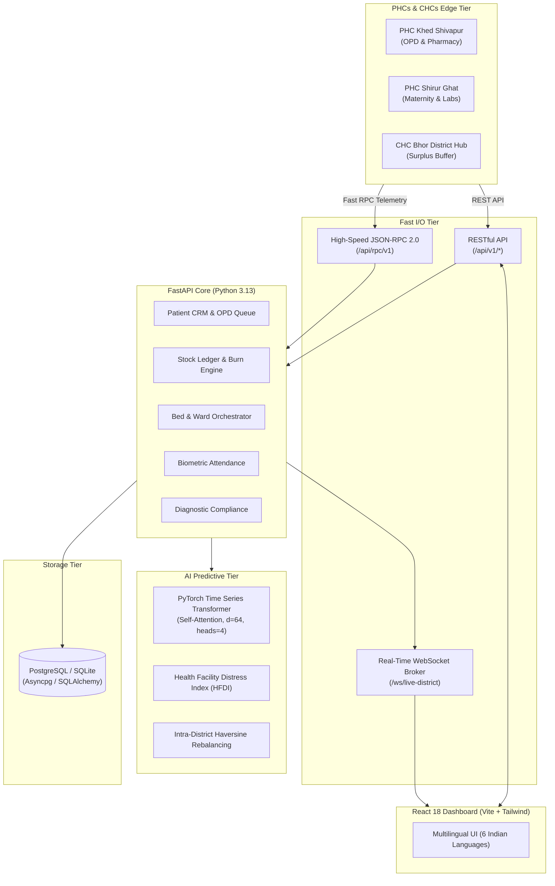

<!--
  File: README.md
  Description: Root Documentation and Overview for SwasthyaGrid AI
-->

# 🏥 SwasthyaGrid AI (ArogyaSutra AI)
### Multilingual AI Platform for Real-Time District Health Centre (PHC/CHC) Management, Time Series Transformer Analytics & Smart Resource Redistribution

[](https://fastapi.tiangolo.com)
[](https://pytorch.org)
[](https://react.dev)
[](https://www.postgresql.org)
[](docs/API_RPC_REFERENCE.md)
[](docs/FEATURES_GUIDE.md)

---

## 📌 Executive Overview

Primary Health Centres (PHCs) and Community Health Centres (CHCs) in rural and semi-urban districts face recurring operational gaps:
- **Medicine Stock-Outs**: Essential antibiotics, ORS, oxytocin, and anti-snake venom run dry before replenishment orders are placed.
- **Unmanaged Footfall Surges**: Seasonal outbreaks (Dengue, Malaria, viral fever) overwhelm local clinics while adjacent PHCs remain underutilized.
- **Bed Invisibility**: Inpatient, maternity, and observation beds are occupied or blocked without central coordination.
- **Doctor Absenteeism**: Unpredictable rosters leave clinics without obstetricians or general physicians.
- **Diagnostic Test Outages**: Reagent stockouts or machine downtimes silently stall diagnostic audits.

**SwasthyaGrid AI** transforms district healthcare administration into a real-time, predictive operating system.

---

## 🚀 Key Modules & Capabilities

| Module | Description | Key Tech |
|---|---|---|
| **Real-Time District Dashboard** | Live operational KPIs, distress heat map, and center-by-center health grid. | React, WebSockets, Tailwind |
| **Patient CRM & OPD Queue** | Digital token issuance, ABHA ID linkage, vitals capture, and triage categories (Immediate Red, Urgent Yellow, Standard Green). | React CRM, REST & Fast RPC |
| **Medicine Inventory & Hazards** | Real-time burn rates, days-of-supply countdown, batch tracking, and early stockout hazard alerts. | SQLAlchemy, Asyncpg, Python |
| **Live Bed Matrix** | Ward allocation across General, Maternity, Pediatric, Emergency, and ICU beds with oxygen support flags. | WebSockets, FastAPI |
| **Doctor Attendance & Roster** | Biometric punch logs, shift timings, and automated specialty coverage audit (e.g. alerts when OBGYN is missing). | Biometric RPC, FastAPI |
| **Diagnostic Test Audits** | 20+ National Free Diagnostics Initiative tests, reagent stock audits, and equipment operational status. | SQLAlchemy ORM |
| **Time Series Transformer** | PyTorch multi-head self-attention deep learning model forecasting 14-day footfall and medicine demand with 90% confidence bands. | PyTorch 2.10, NumPy, SciPy |
| **Smart Redistribution Engine** | Algorithmic intra-district resource balancing transferring surplus stock from central hubs to deficit rural PHCs using Geodesic Haversine routing. | Haversine Optimizer |
| **District Interventions Portal** | Automated Health Facility Distress Index (HFDI) ranking and 1-click administrative order dispatch for District Collector & CMO. | FastAPI, WebSockets |
| **Multilingual Engine** | Instant seamless switching across 6 Indian languages: English, हिन्दी, मराठी, தமிழ், తెలుగు, and বাংলা. | Custom React i18n Hook |

---

## 🏗️ Architecture



---

## ⚡ Quick Start

### 1. Launch with One-Click Script (Windows)
```powershell
# In PowerShell:
.\start.ps1

# Or in Windows CMD:
start.bat
```

### 2. Manual Startup

#### Backend:
```bash
# Set PYTHONPATH
$env:PYTHONPATH="."

# Run backend with virtual environment
backend\.venv\Scripts\python.exe backend\run_backend.py
```
> Backend runs at `http://127.0.0.1:8000`  
> Interactive OpenAPI documentation: `http://127.0.0.1:8000/docs`

#### Frontend:
```bash
cd frontend
npm run dev
```
> Frontend runs at `http://localhost:3000`

### 3. Docker Compose (PostgreSQL + FastAPI + Nginx React)
```bash
docker-compose up --build -d
```

---

## 📚 Complete Documentation

- 📐 [Architectural Design Document](docs/ARCHITECTURE_DESIGN.md) — System design, Time Series Transformer math, and ER diagram.
- 📖 [User & Feature Guide](docs/FEATURES_GUIDE.md) — Complete user manual for all 9 modules and workflows.
- 🔌 [API & RPC Reference](docs/API_RPC_REFERENCE.md) — REST endpoints, JSON-RPC 2.0 methods, and WebSocket events.
- 🚀 [Deployment & Setup Guide](docs/DEPLOYMENT_AND_USAGE.md) — Local setup, PostgreSQL configuration, and Docker deployment.

---

## 🛡️ License
Built for Public Health Infrastructure Optimization under Open Source Healthcare Guidelines.

