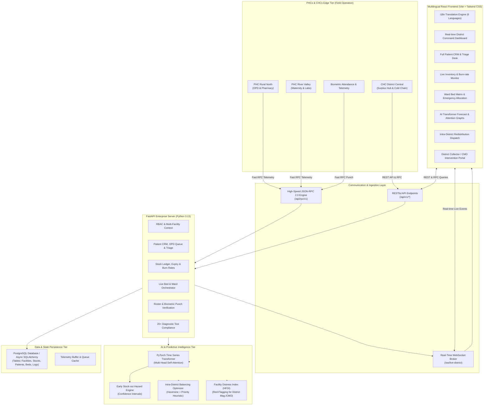
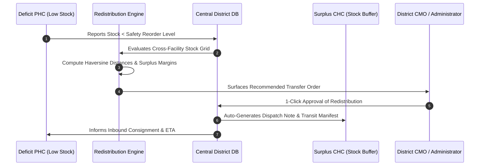
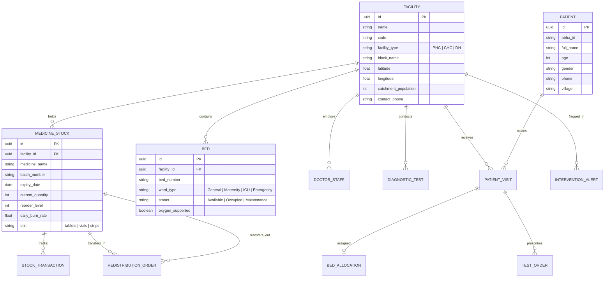

<!--
  File: docs/ARCHITECTURE_DESIGN.md
  Description: Architectural Design Document for SwasthyaGrid AI (ArogyaSutra AI)
  Platform: Real-Time Multilingual Health Centre Management, Time Series Transformer Analytics & Resource Redistribution
-->

# SwasthyaGrid AI — District Health Centre Operating System & Predictive Intelligence Platform
## Architectural Design Document & Technical Specification

---

### Executive Summary

Primary Health Centres (PHCs) and Community Health Centres (CHCs) serve as the bedrock of public healthcare across rural and semi-urban districts. However, manual recording registers, fragmented data silos, and zero real-time cross-facility visibility lead to recurring crises:
1. **Critical Medicine Stock-Outs**: Vital antibiotics, ORS, oxytocin, and anti-snake venom run dry before replenishment orders are placed.
2. **Unmanaged Patient Footfall Surges**: Seasonal outbreaks (e.g., Dengue, Malaria, viral fever) overwhelm local clinics while adjacent PHCs remain underutilized.
3. **Bed Invisibility**: Emergency, maternity, and observation beds are occupied or blocked without central coordination, causing avoidable referral delays.
4. **Doctor & Staff Absenteeism**: Unpredictable rosters leave clinics without obstetricians or general physicians, stranding patients.
5. **Diagnostic Test Bottlenecks**: Reagent stockouts or machine downtimes silently stall diagnostic audits under national free diagnostics programs.

**SwasthyaGrid AI** addresses this challenge with a unified, multilingual real-time platform powered by:
- A high-speed **FastAPI backend** with hybrid **PostgreSQL** persistence and **High-Throughput RPC (Remote Procedure Call)** for rapid telemetry synchronization from rural edge facilities.
- A **Deep Learning Time Series Transformer** (PyTorch self-attention architecture) that forecasts patient footfall and medicine depletion 7–14 days in advance.
- An **Algorithmic Intra-District Resource Redistribution Engine** that computes optimal transfer routes from surplus centres to deficit centres based on geodesic distance, burn rate, and clinical priority.
- An **Automated Administrative Intervention Center** that flags failing or under-resourced centres using a multi-factor Health Facility Distress Index (HFDI).
- A **Multilingual React CRM & Operational Dashboard** supporting English, Hindi (हिन्दी), Tamil (தமிழ்), Telugu (తెలుగు), Bengali (বাংলা), and Marathi (मराठी).

---

### 1. System Architecture Overview

---

### 2. High-Performance RPC Design

In rural healthcare settings, internet connectivity can be intermittent and low-bandwidth. Heavy payloads and high round-trip latency degrade system responsiveness.

SwasthyaGrid AI implements a dedicated **High-Throughput Remote Procedure Call (RPC)** subsystem:
- **Protocol**: JSON-RPC 2.0 with atomic batch execution capability.
- **Payload Compression**: Compact typed dictionaries minimizing JSON serialization overhead.
- **Idempotency**: RPC requests carry client-generated nonces/UUIDs preventing duplicate transactions when intermittent cellular connections drop and retry.
- **Procedures implemented**:
  - `telemetry.syncHealthCenterMetrics`: Atomic transmission of footfall count, doctor check-ins, bed occupancy, and drug issuances in a single TCP round-trip.
  - `inventory.reportDispensation`: High-speed queue for pharmacy dispensations.
  - `patient.quickRegisterTriage`: Rapid batch registration for mass OPD camps.
  - `ai.getDemandForecast`: Accelerated RPC call for edge nodes requesting model inferences without overhead.

---

### 3. Deep Learning Time Series Transformer Architecture

Instead of simple moving averages or static thresholds, SwasthyaGrid AI uses an attention-based **Time Series Transformer** for multi-step multivariate time series forecasting:

#### Model Architecture:
- **Input Features**:
  1. Historical Footfall (Daily rolling OPD counts).
  2. Medicine Consumption Rates (Daily unit dispensations).
  3. Day-of-week, Day-of-month, and Seasonal Indicators (Monsoon, Harvest, Festival vectors).
  4. Local Disease Outbreak Flags (Dengue, Gastroenteritis, Viral Fever reports).
- **Architecture**:
  - `Linear Value Projection` ($d_{\text{model}} = 64$).
  - `Learnable Positional Encoding` representing temporal order.
  - `Multi-Head Self-Attention Layers` ($N = 3$ layers, $H = 4$ heads) capturing long-term dependencies and weekly cycles.
  - `Feed-Forward Networks` with GeLU activation and Dropout ($0.1$).
  - `Decoders with Linear Output Projections` generating 7 to 14 days future horizon predictions along with upper/lower $90\%$ confidence bounds.

#### Mathematical Formulation of Early Stock-Out Warning:
Let $S_t$ be current stock of medicine $m$ at facility $f$.
Let $\hat{D}_{t+k}$ be the transformer-predicted demand on day $t+k$, with standard deviation $\sigma_k$.
The cumulative expected depletion over horizon $H$ is:
$$\hat{C}_H = \sum_{k=1}^H \hat{D}_{t+k}$$
The **Estimated Days Until Stockout** $\tau$ is defined as the minimum $\tau$ such that:
$$\sum_{k=1}^{\tau} \left(\hat{D}_{t+k} + z_{\alpha} \sigma_k\right) \ge S_t$$
If $\tau \le 2$, the system triggers a **CRITICAL HAZARD** alert.
If $2 < \tau \le 7$, the system triggers an **EARLY WARNING** alert.

---

### 4. Smart Resource Redistribution Engine

When one PHC experiences an acute shortage while another PHC or CHC within the same district has surplus stock, the platform calculates automated inter-facility transfer orders.

#### Optimization Criteria:
1. **Distance Minimization**: Haversine formula between coordinates $(\phi_1, \lambda_1)$ and $(\phi_2, \lambda_2)$ to guarantee lowest transport time and fuel expenditure.
2. **Surplus Safety Margin**: Source facility must maintain at least 21 days of safe buffer stock after donation.
3. **Clinical Urgency Weight**: Anti-snake venom, Oxytocin, and pediatric antibiotics are weighted with maximum urgency.

---

### 5. Health Facility Distress Index (HFDI) & Administrative Flags

District Magistrates and Chief Medical Officers (CMOs) oversee dozens of facilities. They need automated, prioritized triage of which health centres need immediate administrative intervention.

The platform calculates a dynamic **Health Facility Distress Index (HFDI)** ($0 - 100$ scale):
$$\text{HFDI} = w_1 \cdot \mathcal{S}_{\text{stockout}} + w_2 \cdot \mathcal{A}_{\text{absenteeism}} + w_3 \cdot \mathcal{B}_{\text{bed\_strain}} + w_4 \cdot \mathcal{T}_{\text{diagnostic\_failure}}$$

- **HFDI $\ge 65$ (RED FLAG)**: Immediate district intervention required. Auto-triggers warning notification, pre-populates emergency action slip (e.g., dispatch Mobile Medical Unit or emergency stock reallocation).
- **$35 \le \text{HFDI} < 65$ (AMBER FLAG)**: Elevated operational strain.
- **$\text{HFDI} < 35$ (GREEN)**: Nominal, resilient operation.

---

### 6. Multilingual Architecture & Localization

The user interface supports 6 major Indian languages seamlessly:
- **English** (`en`)
- **Hindi** (`hi` — हिन्दी)
- **Tamil** (`ta` — தமிழ்)
- **Telugu** (`te` — తెలుగు)
- **Bengali** (`bn` — বাংলা)
- **Marathi** (`mr` — मराठी)

Translations cover:
- All navigation headers, labels, and status badges.
- Clinical severity categories (Emergency, Immediate, Outpatient, Discharged).
- Stock urgency alerts and operational flags.
- Action buttons and modal dialogues.
- RTL/LTR compatibility and local numeral formatting.

---

### 7. Database Entity-Relationship Schema

